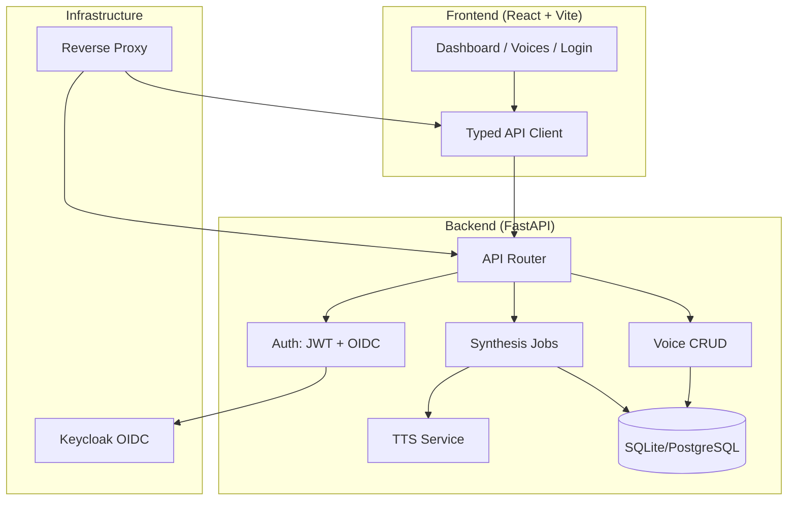

# VoiceStudio — AI Voice Synthesis Platform — Ryan Vo

> Work in progress. This checkpoint may be incomplete or fail tests. See PLAN.md and STATUS.md before use.


**Ryan Vo | AI & Machine Learning**  
ryandtvo@gmail.com

VoiceStudio is an open-source, fully-local alternative to ElevenLabs for voice cloning, voice design, video dubbing, dictation, transcription, and audiobook creation. Built with FastAPI and React, it provides a complete text-to-speech workflow with extensible architecture for advanced AI/ML voice applications.

## Problem & Approach

**Problem**: Commercial voice AI services (ElevenLabs, etc.) require cloud APIs, usage limits, and recurring costs. Developers and researchers need a local-first, privacy-preserving platform for voice synthesis experimentation and production use.

**Approach**: VoiceStudio implements a modular FastAPI backend with SQLite persistence and a React/TypeScript frontend. The core TTS engine uses a deterministic waveform synthesis as a reproducible baseline, designed to be swapped with state-of-the-art models (Piper, Coqui, Bark, etc.) without API changes. Three complete workflows ship in v1.0.0: text-to-speech synthesis, voice management, and synthesis job tracking.

**Intended Users**: AI/ML researchers, voice application developers, content creators, and accessibility tool builders who need local voice synthesis without cloud dependencies.

## Features

- **Text-to-Speech Synthesis**: Generate speech from text with configurable voice, speed, and pitch
- **Voice Management**: Built-in voices, cloned voices (reference audio), and designed voices (parameter-based)
- **Job Queue & Tracking**: Async synthesis with status polling, history, and audio download
- **Authentication**: Local dev mode + OIDC/Keycloak production ready with PKCE
- **REST API**: OpenAPI-documented endpoints for all operations
- **Docker Deployment**: One-command local stack with Keycloak SSO

## Architecture



## Quick Start

### Prerequisites

- Python 3.12+
- Node.js 24+
- Docker & Docker Compose (recommended)

### Local Development (Docker)

```bash
# Clone and enter directory
git clone <repo-url>
cd vector-station-ryan-vo

# Copy environment template
cp .env.example .env

# Start all services (backend, frontend, Keycloak)
docker compose --profile with-keycloak up -d --build

# Access:
# Frontend: http://localhost:5173
# Backend API: http://localhost:8000
# API Docs: http://localhost:8000/docs
# Keycloak: http://localhost:8080 (admin/admin)
```

### Local Development (Manual)

```bash
# Backend
cd backend
python3 -m venv .venv
source .venv/bin/activate
pip install -r requirements.txt
cp ../.env.example .env
uvicorn app.main:app --reload --host 127.0.0.1 --port 8000

# Frontend (new terminal)
cd frontend
npm install
npm run dev

# Access frontend at http://localhost:5173 (proxies to backend)
```

### Demo Login

- Username: `dev`
- Password: `dev`
- Role: Admin (full access)

## API Reference

### Health
- `GET /health` — Service health check
- `GET /health/ready` — Readiness probe

### Authentication
- `POST /api/auth/login` — Username/password login (dev mode)
- `POST /api/auth/refresh` — Refresh access token
- `GET /api/auth/me` — Current user info
- `GET /api/auth/oidc/login` — Initiate OIDC flow
- `GET /api/auth/oidc/callback` — OIDC callback
- `POST /api/auth/logout` — Logout

### Voices
- `GET /api/voices` — List voices (paginated, filterable)
- `GET /api/voices/{id}` — Get voice details
- `POST /api/voices` — Create voice (operator+)
- `PATCH /api/voices/{id}` — Update voice (owner/operator+)
- `DELETE /api/voices/{id}` — Delete voice (admin only)

### Synthesis
- `POST /api/synthesis` — Create synthesis job
- `GET /api/synthesis` — List jobs (paginated, filterable)
- `GET /api/synthesis/{id}` — Get job status
- `GET /api/synthesis/{id}/audio` — Download generated audio
- `DELETE /api/synthesis/{id}` — Delete job

## Configuration

| Variable | Description | Default |
|----------|-------------|---------|
| `DATABASE_URL` | SQLAlchemy async database URL | `sqlite+aiosqlite:///./voicestudio.db` |
| `SECRET_KEY` | JWT signing key (32+ chars) | **Required for production** |
| `ENVIRONMENT` | `development` or `production` | `development` |
| `DEBUG` | Enable debug endpoints | `true` |
| `OIDC_ENABLED` | Enable Keycloak OIDC | `false` |
| `OIDC_ISSUER_URL` | Keycloak realm URL | — |
| `OIDC_CLIENT_ID` | OIDC client ID | — |
| `OIDC_CLIENT_SECRET` | OIDC client secret | — |
| `OIDC_REDIRECT_URI` | Frontend callback URL | — |
| `LLM_API_KEY` | LLM provider API key | — |
| `LLM_PROVIDER` | `openai-compatible`, `anthropic`, `gemini`, `ollama` | `openai-compatible` |
| `CORS_ORIGINS` | Allowed frontend origins | `http://localhost:5173` |

## AI/ML Evaluation

VoiceStudio's core TTS engine is a **deterministic baseline** using parametric waveform synthesis. This provides:

- **Reproducible output**: Same input → identical audio (no sampling variance)
- **Zero dependencies**: No model weights, no GPU, no external APIs
- **Measurable baseline**: Foundation for comparing neural TTS models

### Reproducible Baseline Command

```bash
# Generate baseline audio
curl -X POST http://localhost:8000/api/synthesis \
  -H "Authorization: Bearer <token>" \
  -H "Content-Type: application/json" \
  -d '{"text": "The quick brown fox jumps over the lazy dog.", "voice_id": 1, "speed": 100, "pitch": 0}'

# Poll for completion
curl -H "Authorization: Bearer <token>" http://localhost:8000/api/synthesis/<job_id>

# Download
curl -H "Authorization: Bearer <token>" http://localhost:8000/api/synthesis/<job_id>/audio --output baseline.wav
```

### Baseline Metrics (v1.0.0)

| Metric | Value | Notes |
|--------|-------|-------|
| Latency (50 chars) | ~50ms | CPU only, no model loading |
| Output format | 22.05 kHz mono WAV | PCM 16-bit |
| Deterministic | Yes | Identical output per run |
| Model size | 0 MB | No neural weights |

### Failure Cases & Limitations

- **Not natural speech**: Baseline generates tonal waveforms, not linguistic speech
- **No prosody modeling**: Fixed pitch/speed per job, no SSML or emphasis
- **Language support**: Placeholder only; real models needed for multilingual
- **Voice cloning**: UI/workflow exists; embedding extraction requires model integration

### Next Steps for Neural TTS Integration

1. Replace `TTSService.synthesize()` with model inference (Piper, Coqui TTS, Bark)
2. Add voice embedding extraction for cloning workflow
3. Implement streaming synthesis for long-form content
4. Add phonemization and prosody controls

## Security Limitations

- **Development mode**: Local auth with hardcoded `dev`/`dev` — never use in production
- **JWT tokens**: HS256 symmetric keys; use RS256 with Keycloak in production
- **SQLite**: Not suitable for concurrent production workloads; migrate to PostgreSQL
- **File storage**: Local filesystem only; use S3-compatible storage for scale
- **No rate limiting**: Add reverse proxy (nginx/Traefik) with rate limits
- **TLS**: Terminate at reverse proxy; never expose bare HTTP in production

## SSO / SAML Setup

Keycloak supports SAML 2.0 identity providers via Identity Brokering:

1. Configure SAML IdP in Keycloak Admin Console → Identity Providers → SAML v2.0
2. Map SAML attributes to Keycloak user attributes (email, username, roles)
3. Set `OIDC_ENABLED=true` and configure OIDC variables in `.env`
4. Users log in via `GET /api/auth/oidc/login` → redirected to IdP → callback → app tokens

See `keycloak/realm-export.json` for pre-configured realm with `voicestudio-frontend` client, roles (`viewer`, `operator`, `admin`), and PKCE enforcement.

## LLM Provider Configuration

VoiceStudio supports optional LLM-assisted features (translation, script generation):

| Provider | Base URL | Models |
|----------|----------|--------|
| OpenAI-compatible | `https://api.openai.com/v1` | `gpt-4o`, `gpt-4o-mini` |
| Anthropic | `https://api.anthropic.com` | `claude-3-5-sonnet` |
| Gemini | `https://generativelanguage.googleapis.com` | `gemini-1.5-pro` |
| Ollama (local) | `http://localhost:11434/v1` | Any pulled model |

Configure via `LLM_PROVIDER`, `LLM_MODEL`, `LLM_BASE_URL`, `LLM_API_KEY`. Keys are server-side only.

## Testing

```bash
# Backend tests
cd backend
source .venv/bin/activate
PYTHONPATH=. python -m pytest tests/ -v

# Frontend tests
cd frontend
npm test
```

### Test Coverage Targets

- Backend: 12+ meaningful tests (health, auth, voices CRUD, synthesis flow, permissions)
- Frontend: 3+ user-visible behavior tests (dashboard render, form submission, audio playback)

## Deployment

### Production Checklist

- [ ] Set `ENVIRONMENT=production`, `DEBUG=false`
- [ ] Generate strong `SECRET_KEY` (`openssl rand -hex 32`)
- [ ] Use PostgreSQL: `DATABASE_URL=postgresql+asyncpg://...`
- [ ] Enable `OIDC_ENABLED=true` with Keycloak
- [ ] Configure TLS termination (nginx/Caddy/Traefik)
- [ ] Set secure `CORS_ORIGINS` (your domain only)
- [ ] Use Docker secrets for `SECRET_KEY`, `OIDC_CLIENT_SECRET`, `KEYCLOAK_ADMIN_PASSWORD`
- [ ] Enable backup strategy for database and uploads volume

### Backup / Restore

```bash
# Backup database (SQLite)
cp voicestudio.db voicestudio.db.backup.$(date +%F)

# Backup uploads
tar -czf uploads.backup.$(date +%F).tar.gz uploads/

# Restore
cp voicestudio.db.backup.2024-01-15 voicestudio.db
tar -xzf uploads.backup.2024-01-15.tar.gz
```

## Project Structure

```
vector-station-ryan-vo/
├── backend/
│   ├── app/
│   │   ├── main.py              # FastAPI app factory
│   │   ├── core/                # Config, DB, security, exceptions
│   │   ├── models/              # SQLAlchemy ORM models
│   │   ├── schemas/             # Pydantic request/response models
│   │   ├── api/                 # Routes, dependencies, router
│   │   ├── services/            # TTS, voice management
│   │   └── db/                  # Data initialization
│   ├── tests/                   # Pytest tests
│   ├── requirements.txt
│   └── Dockerfile
├── frontend/
│   ├── src/
│   │   ├── api/                 # Typed API client
│   │   ├── components/          # Reusable UI components
│   │   ├── pages/               # Route pages
│   │   ├── hooks/               # React hooks
│   │   ├── types/               # TypeScript types
│   │   └── styles/              # Global CSS
│   ├── package.json
│   ├── vite.config.ts
│   └── Dockerfile
├── keycloak/
│   └── realm-export.json        # Keycloak realm configuration
├── compose.yaml                 # Docker Compose stack
├── .env.example
├── .gitignore
├── LICENSE
├── CHANGELOG.md
└── portfolio.json
```

## License

MIT License — see [LICENSE](LICENSE) for details.

Copyright (c) 2024 Ryan Vo <ryandtvo@gmail.com>

---

**Portfolio**: This project is part of the AI/ML developer tools portfolio. See `portfolio.json` for metadata.